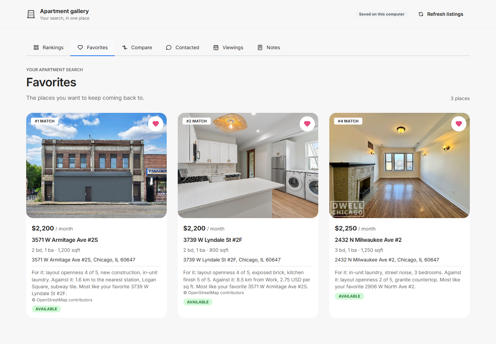
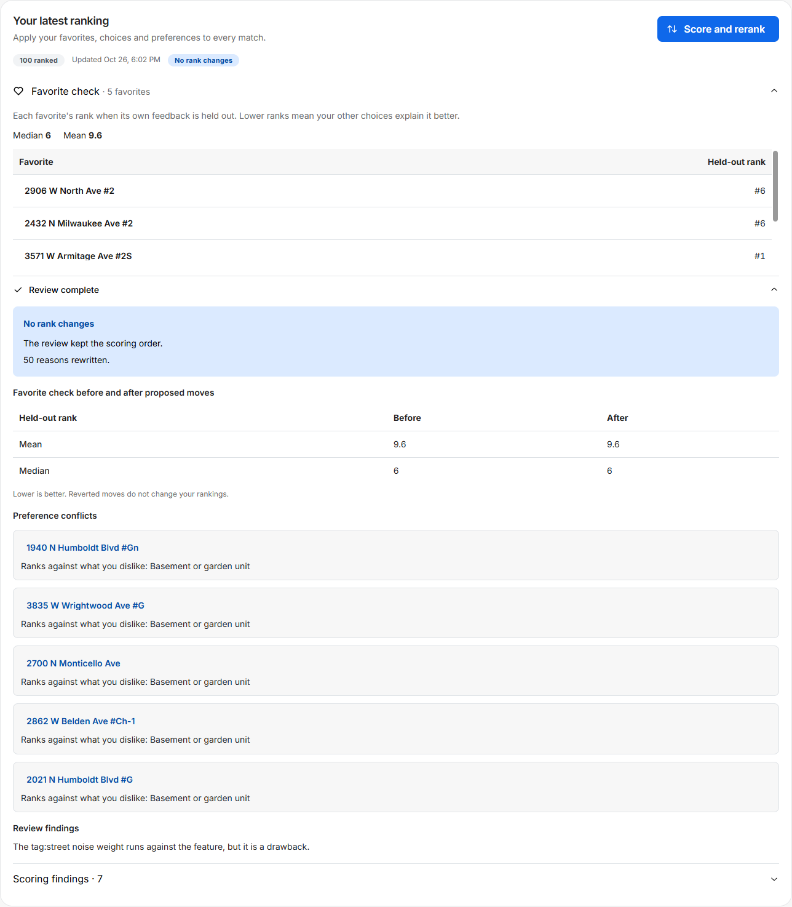
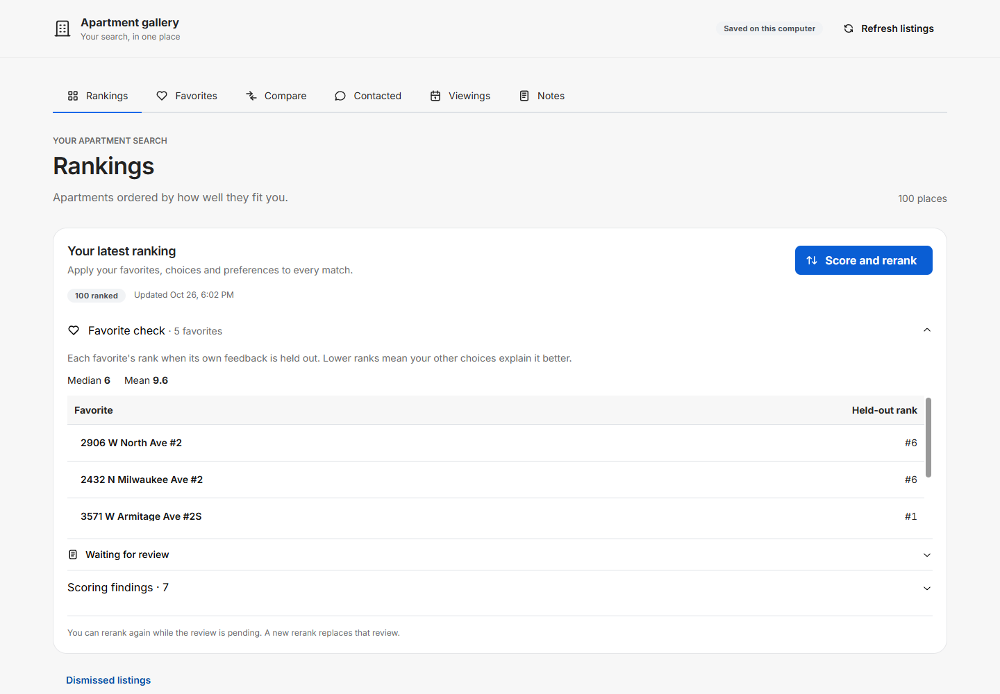

# End-to-end run with real crawling, 2026-10-26

Question: does apt-scraper on `main` work end to end for a new user, from the first conversation through a real Zillow search, extraction, reranks, Compare, notes, a criteria change and a re-save, and what does a new user run into on the way?

Result: every step worked, and five defects turned up. The search found 125 listings in 16 minutes without a block. Every shown listing had a feature record 15 minutes after the search ended. Reranks showed the new order and every held-out rank within 0.35 seconds of the click. Compare answers and a note changed the next rerank as specified. Five defects were found: a user without a messaging gateway is never asked for Compare answers ([0043](../tickets/0043-compare_invitation_without_gateway.md)), the explanation's station distance reads as a separate drawback ([0044](../tickets/0044-station_name_in_reason_list.md)), the search status says "not started" during the first run ([0045](../tickets/0045-search_status_during_first_run.md)), the agent overstates how many listings a criteria change hid ([0046](../tickets/0046-criteria_change_hidden_count.md)), and the review pass reads preference readings newer than the rerank it reviews ([0047](../tickets/0047-review_reads_later_readings.md)).

## Setup

Code under test: `main` at `9136e65`. `main` later gained `2949eb9`, which adds one ticket file and changes no code. Hermes 0.22.5 with its Python 3.14.9, on the owner's Windows 11 workstation.

The throwaway Hermes root is `%TEMP%\apt-e2e-root` (`C:\Users\stjep\AppData\Local\Temp\apt-e2e-root`). It holds the profile `apt-e2e`, installed with `hermes profile install ./profile --name apt-e2e --yes` and followed by the installer's post-profile steps in `install.ps1` order: `skills install google-workspace`, `search-run.py install` with Hermes's Python (8 s), `cron resume` of the four jobs, the `delegation.model` check (`sonnet`, already set), the provider plugin, and the test message ("ready" in 15 s). The computer-use driver, the gateway service, the dashboard and the Start menu entries were left out, because they act on the machine rather than the root. The root's own gateway, which Hermes started on demand (`gateway run --idle-exit`, PID 30364, `hermes_home` the root), ran the jobs. It was stopped at the end. The owner's `gateway-starts.log` had 15 lines before and after, and the owner's profiles were not opened.

Conversations ran as `hermes -p apt-e2e chat -q … -Q`, resumed with `--resume` across turns. The gallery ran on port 18790 with `open --no-browser`, `HERMES_HOME` set to the profile and `USERPROFILE` set to `home\` inside the root, so its connection record stayed in the root. Playwright 1.56 drove it in headless Chromium. The headless gallery loaded the real Zillow photos.

Evidence is under `results\` in the root: conversation transcripts in `chat\`, screenshots in `screenshots\`, and the JSON and text files named below. The scripts that produced them are in `scripts\`.

## Pass and fail

| Step | Result | Evidence in `results\` |
| --- | --- | --- |
| 1. First conversation and interview | Pass | `chat\turn01.txt` to `turn06.txt`, `chat\interview-transcript.txt`, `interview-checks.txt` |
| 2. One real search against Zillow | Pass, with defect 0045 | `search-cron-output.md`, `search-status-during-run.txt`, `search-status-after.json`, `criteria-audit-after-search.json`, `cat-judgment-evidence.jsonl` |
| 3. Feature extraction | Pass | `features-status-after-extraction.json`, `records-check.json`, `cron-wakes.txt`, `usage-final.json` |
| 4. Gallery, favorites, reranks, Compare, review | Pass, with defects 0043, 0044 and 0047 | `01-after-search-tour.json`, `02-rerank1.json`, `ranking-status-rerank2.json`, `ranks-after-review2.json`, `04-compare.json`, `compare-effect.txt`, `07-rerank5.json`, `ranking-status-rerank5.json`, `ranking-status-rerank6-reviewed.json`, `11-review-panel.txt`, `no-model-call-before-review.txt`, `chat\after-extraction.txt` |
| 5. Note read and used | Pass | `08-note.json`, `note-readings.json`, `note-effect.txt` |
| 6. Must-have change in a `-Q` conversation | Pass, with defect 0046 | `chat\price-change.txt`, `price-change-save.txt`, `criteria-audit-after-price-change.json`, `10-after-price-change-tour.json` |
| 7. Re-save of unchanged listings | Pass | `resave-check.txt` |
| Notes tab conversation | Not verified | `12-notes-tab.txt` |

### 1. First conversation and interview

"Hello" got the connection notice first: Gmail, Google Calendar and the messaging gateway not connected, iMessage unavailable off macOS, and an offer to set them up. The interview's first questions followed in the same reply. Declining the connections and answering took six turns. The stored settings, from `settings.py status` (exit 0, `complete: true`):

- criteria: Lake View and Logan Square, Chicago, at most 2,600 USD a month, at least 2 bedrooms, no size limit, flexible move-in, the must-have "Cats allowed",
- likes "Lots of daylight", "In-unit laundry", "Dishwasher", "Exposed brick", dislikes "Carpet", "Basement or garden unit",
- places Work (233 S Wacker Dr) and First Ascent Avondale (3516 N Spaulding Ave),
- location priorities: places high, rapid transit medium, Logan Square high, Lake View medium,
- Zillow, and viewings on weekdays 18:00 to 20:00 and Saturdays 10:00 to 14:00, America/Chicago.

Places were saved once (`settings4.json` in the transcript), and the store's `geocodes` table holds exactly the two addresses with one shared `geocoded_at`, found as "Willis Tower, 233, South Wacker Drive" and "First Ascent Avondale, 3516, North Spaulding Avenue". `geocode` in `geodata.py` sends one request per address the store does not know, with no retry, so this was one Nominatim request each. The agent said both locations back with "© OpenStreetMap contributors". When the interview completed, the agent ran the search job with `cronjob_manage` (`run`, `apt-scraper-search`).

The six stated preferences were read in the first features run, each into the features it names (`preference-readings.json`): daylight into natural light and window size, the two flags, `tag:exposed brick`, `floor:carpet` disliked and `unit_level:garden` disliked.

### 2. Search

The run started at 22:19:20 UTC and its script finished at 22:35:37: 125 new listings, 0 changed, 0 gone, 0 unreadable, no error and no block. The run's agent then judged "Cats allowed" for all 125 in five batches and the job completed at 22:38:28. The search job was paused at 22:38:40 so that no second search ran.

`apply_criteria` kept exactly the matching listings. An independent check of each stored listing against the saved criteria (`criteria_audit.py`, which does not use `matching.py`) agreed with the store on all 125: 100 shown, 25 hidden, each hidden one because "Cats allowed" was judged false. All 25 false judgments have "No pets" in the listing text. Of the 20 judged "does not say", several state only dogs or contradict themselves, such as "Pets are ok" next to "Pets allowed: No pets". No true judgment contradicts the text.

During the run, `search.py status` reported `"state": "not started"` and the problem "The search has not run yet." with exit 3, while its own `running_since` was set ([0045](../tickets/0045-search_status_during_first_run.md)). A conversation at that moment ("How is the search going?") did not start a second run, but told the user "The search script reports 'not started'".

### 3. Feature extraction

Every shown listing got a record with no failure. The first features run, at 22:26, fetched CTA's 143 stations and read the six preferences. Three wakes extracted the 100 listings:

| Wake | Listings | Subagents' API calls | Wall time |
| --- | --- | --- | --- |
| 22:37:11 to 22:42:02, on schedule | 41 | 165 | 4 min 51 s |
| 22:42:33 to 22:47:13, started with `hermes cron run` | 50 | 211 | 4 min 40 s |
| 22:47:54 to 22:51:05, started with `hermes cron run` | 9 | 36 | 3 min 11 s |

The first wake found only the 41 listings the search's agent had shown by then. The second stopped at the 50-extraction cap and left 9 for the next run. The last record was saved 15 minutes after the search's script ended. On the 10-minute schedule alone, the third wake would have started about 10 minutes later.

The 100 records hold 1,236 unique photos of 1,262 listed, each with a room type and numbered without gaps. Floors: 42 hardwood, 36 mixed, 21 tile or vinyl, 1 not shown. Unit levels: 18 garden or basement, 14 ground, 15 middle, 12 top, 41 not shown. 62 tags are in use and the tag list grew from 72 seed tags to 73.

No main session holds an image: the interview, the other conversations, the search wake, the five features wakes and the three review wakes have no image part and no `vision_analyze` call. Each of the 100 extraction subagent sessions holds its sheets. None of the 100 subagents opened a photo at full resolution, although `vision_analyze` was available to them: the job has the vision toolset and Hermes withholds only `delegate_task`, `clarify`, `memory`, `send_message` and `cronjob_manage` from subagents (`DELEGATE_BLOCKED_TOOLS` in `tools/delegate_tool_toolsets.py`).

### 4. Gallery, reranks, Compare and review

The six tabs show in the specified order: Rankings, Favorites, Compare, Contacted, Viewings, Notes. Before any rerank, Rankings showed the 100 listings under "Awaiting ranking" with their main photos.

Favorites were five upper-floor Logan Square units with in-unit laundry, dishwasher and hardwood: 3739 W Lyndale St #2F, 3571 W Armitage Ave #2S, 2432 N Milwaukee Ave #2, 2906 W North Ave #2 and 1741 N California Ave #1742-2R, each favorited with its card's heart button. A selector error in the test script favorited only 2906 W North Ave #2 before the first rerank. The other four followed before the second.

| Rerank | After | Ranked | Held-out ranks of the favorites | Median, mean | Exploration ranks | Click to visible, server |
| --- | --- | --- | --- | --- | --- | --- |
| 1 | One favorite | 100 | 11 | 11, 11 | 7, 14 | 344 ms, 0.283 s |
| 2 | Five favorites | 100 | 8, 4, 1, 23, 2 | 4, 7.6 | 7, 14 | not measured |
| 3 | Two Compare answers | 100 | 7, 5, 1, 25, 1 | 5, 7.8 | 7, 14 | not measured, 0.23 s |
| 5 | Nothing new | 100 | 7, 5, 1, 25, 1 | 5, 7.8 | 7, 14 | 242 ms, 0.216 s |
| 6 | The note's reading | 100 | 6, 6, 1, 34, 1 | 6, 9.6 | 7, 14 | 279 ms, 0.25 s |

Held-out ranks are in the order North Ave, Milwaukee Ave, Armitage Ave, California Ave, Lyndale St. Rerank 2's exploration ranks are from the store's ranks after it. Click to visible runs from the click on Score and rerank until the first card shows "#1 match" and every held-out rank is on screen after the "Scoring" state. Reranks 3 and 4 were attempts at that measurement whose check fired too early or never. Both reranked, and each replaced the review waiting before it. No exploration listing had a favorite, dismissal, contact request, note or pairwise answer when its rerank ran (`reranks-summary.txt`). Each rerank also reported 0 weak labels from implicit signals and no improvement.

No model call came between a rerank and its review: no session with an API call started between rerank 2 at 22:56:15 and its review session at 22:57:11. The gallery made no `/api/chat` request.

Reasons and explanations: each ranked listing's reason names what moved its score and the favorite it most resembles, and its explanation's contributions add up to its score (110 contributions for 2069999766, score 3.716). Two reasons mislead:

- "Against it: 1.6 km to the nearest station, Logan Square, subway tile." The station's name, Logan Square, follows its distance after a comma, in a list separated by commas, so it reads as the area Logan Square counting against the listing ([0044](../tickets/0044-station_name_in_reason_list.md)). The area's contribution is +0.44 for that listing. 
- "For it: in-unit laundry, street noise, 3 bedrooms." The concern tag "street noise" weighs +0.60 because one favorite has it. The explanation is faithful to the model, and the review's finding names the same weight.

Compare showed one question at a time, both listings with price, rooms, size and address. Both answers chose the listing ranked lower, and both counted at the next rerank:

| Chosen, rank before | Other, rank before | Ranks after |
| --- | --- | --- |
| 2455 N Ridgeway Ave #1, 32 | 3555 W Lyndale St APT 1C, 31 | 12 and 47 |
| 2449 N Ridgeway Ave APT 1, 18 | (Undisclosed Address), 11 | 6 and 35 |

Nobody asked the user to answer Compare questions. With no messaging gateway, the features job never sends the invitation and records no problem (`send_compare_invitation` in `features.py`), so `features.py status` exits 0. `features.json` has no `compare_invited_at`. A conversation after extraction ("Hi, anything new?") reported the 100 new listings and the connections and did not mention Compare ([0043](../tickets/0043-compare_invitation_without_gateway.md)).

The review pass ran three times through the `apt-scraper-review` job:

| Review of | Waited | Ran | Outcome | Reasons rewritten | Flags | Findings |
| --- | --- | --- | --- | --- | --- | --- |
| Rerank 2 | 56 s | 58 s | no moves, 4 before 4 after, mean 7.6 | 50 | 4 garden units, dislike "Basement or garden unit" | street noise weighs high though it is a drawback |
| Rerank 5 | 55 s | 62 s | no moves, 5 and 7.8 | 50 | 6 garden units | galley kitchen and kitchen size run against "the stated dislikes"; window size below the stated like; street noise |
| Rerank 6 | 1 min 47 s | 51 s | no moves, 6 and 9.6 | 50 | 5 garden units | street noise |

The gallery showed the result with the check before and after, the flags and the findings.  The finding on the review of rerank 5 rests on the note's reading, which was saved at 23:00:55, after that rerank finished at 23:00:16 and before the review task was written at 23:01:11. The review task is built from the store at handing time, so it set the rerank's weights against starting weights the rerank did not use ([0047](../tickets/0047-review_reads_later_readings.md)). No review proposed a move, so the revert path was not exercised. Ticket 0027 verified it with a controlled review.

### 5. Note

The note "Love the big windows and the open layout. The tiny galley kitchen and the ceiling fans are a shame though." on 1741 N California Ave #1742-2R was saved with Save note at 23:00:29. A features run, started with `hermes cron run`, read it at 23:00:55 in 4 API calls as mixed, liking `rating:window_size` and `rating:layout_openness` and disliking `rating:kitchen_size`, `tag:galley kitchen` and `tag:ceiling fan`. Rerank 6 used it. From rerank 5 to rerank 6 the weights moved: window size 0.734 to 1.144, layout openness 0.778 to 1.167, kitchen size 0.269 to −0.133, galley kitchen 0.389 to −0.008, ceiling fan −0.302 to −0.619. The listing is a favorite, so the note's mixed sentiment adds no label, and its held-out rank fell from 25 to 34.

### 6. Must-have change

"Actually, lower my budget to at most 2,300 USD a month." in a new `-Q` conversation was saved in 22 s (4 API calls). The gallery went from 100 to 50 listings, and the independent check agreed with the store on all 125 listings. Favorites went from five to three. The agent said the change "hid 75 listings that were over the new limit". The change hid 50. The other 25 were already hidden for "Cats allowed", and `save` prints `outside: 75`, the total, which the interview skill tells the agent to report ([0046](../tickets/0046-criteria_change_hidden_count.md)).

### 7. Re-save

Saving the stored content of all 125 listings again through `upsert_listing` returned `changed: false` for each. The features job, started with `hermes cron run`, then ended with "Script gate returned `wakeAgent=false` — agent skipped". The profile's API call count stayed at 503 and its subagent count at 100.

## Timings

| Step | Time |
| --- | --- |
| Profile install through the plugin | 1 min 11 s |
| Test message | 15 s |
| Interview, 6 turns | 2 min 32 s (turns of 28, 14, 16, 15, 23 and 27 s) |
| Search, script | 16 min 17 s for 125 listings |
| Search, judging the must-have | 2 min 51 s |
| Extraction of 100 listings, from the first wake to the last record | 13 min 54 s |
| Rerank, click to visible | 242 to 344 ms on 100 listings |
| Rerank, server | 0.216 to 0.283 s |
| Review pass, rerank to saved review | 1 min 51 s to 2 min 35 s |
| Note saved to note read | 26 s, with the run started by hand |
| Criteria change conversation | 22 s |

## Token use

All of it on Sonnet through the Claude subscription provider. Input excludes cache reads and writes.

| Sessions | Count | API calls | Input | Output | Cache read | Cache write |
| --- | --- | --- | --- | --- | --- | --- |
| Extraction subagents | 100 | 412 | 38,024 | 162,532 | 5,618,010 | 1,369,319 |
| Features wakes | 5 | 36 | 1,932 | 33,902 | 1,029,649 | 187,531 |
| Search wake | 1 | 13 | 398 | 13,895 | 881,805 | 129,073 |
| Review wakes | 3 | 12 | 1,140 | 23,411 | 341,081 | 132,736 |
| Interview | 1 | 21 | 424 | 4,108 | 641,250 | 17,171 |
| Other conversations and the test message | 4 | 13 | 1,514 | 2,058 | 292,679 | 38,314 |
| Cron runs without a wake | 38 | 0 | 0 | 0 | 0 | 0 |
| Total | 152 | 507 | 43,432 | 239,906 | 8,804,474 | 1,874,144 |

An extraction averaged 4.1 API calls, 1,625 output tokens and 56,000 cache-read tokens.

## What a new user runs into

The five defects above, then:

- With a must-have, nothing shows in the gallery until the first search ends: the run applies the criteria at its end and the must-have needs the model's judgment, so the first listings appeared 17 to 19 minutes after the interview.
- The interview suggested apartments.com and domu.com, which the search cannot read. Accepting them would make every later conversation report "The search has no reader for …", as the search skill handles it.
- The interview asked for size "in m² or sqft" and for "rooms" from a Chicago user. It saved the answer "at least 2 bedrooms" correctly.
- Every conversation offers the connections again, as specified. In three of them, the offer came after other news, although `SOUL.md` says to start the reply with it.
- Reasons learned from five favorites can read oddly: "street noise" under "For it", and "storage 4 of 5" and "2 bathrooms" under "Against it". Explanations print "1 bathrooms".
- Zillow's "(Undisclosed Address)" is the title of one listing in Rankings and Compare.
- After the criteria change, the Rankings panel kept "100 ranked" beside "50 places", and Favorites showed ranks #1, #2 and #4 until the next rerank. This follows the spec: ranks change only on a rerank.
- The search's agent ended its run with "80 are shown in the gallery and 45 are hidden", where the store had 100 and 25. Nobody reads that line, because the job delivers locally.

## Not verified

- The Notes tab conversation. `chat.py` refuses any profile not named `apt-scraper` and needs Hermes's own environment. The throwaway profile had another name, and the gallery ran on Hermes's bare Python. The tab showed "Notes needs the Hermes Python environment. Open this gallery through hermes -p apt-scraper."
- The installer itself, the dashboard and the computer-use driver.
- Contact, viewings and the connections, which need Google and Telegram.
- Spec › Acceptance "Ranking" (unseen listings the tester judges alike rank above the rest of similar price) needs a tester's judgment of the unseen listings, which this run did not collect.
- A review that is reverted: all three reviews proposed no move.

## Kept for the owner

The root `C:\Users\stjep\AppData\Local\Temp\apt-e2e-root`, with its gateway stopped. The profile `profiles\apt-e2e` holds the store, the cron outputs under `cron\output\` and the sessions in `state.db`. The search job is paused, and the other three jobs are active and run again when Hermes starts that root's gateway. The Playwright install used by the scripts is in `%TEMP%\apt-e2e-tools`.
